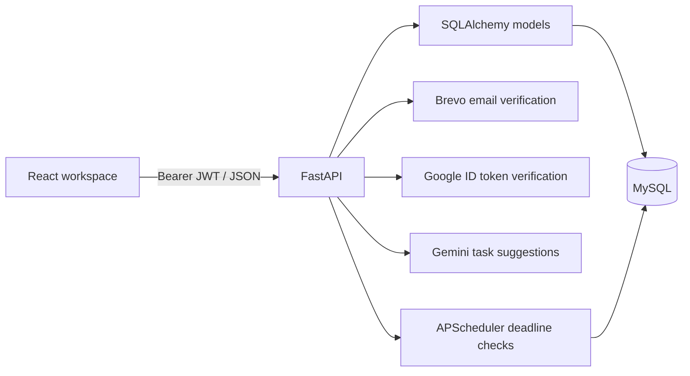

# TaskFlow

TaskFlow is a team project management app. The planned stack is FastAPI, SQLAlchemy, MySQL, and React.

## Project layout

- `backend/` — FastAPI service
- `frontend/` — Vite + React app
- `project_plan.md` — feature scope and implementation plan

## Run the backend

```powershell
cd backend
py -m venv .venv
.\.venv\Scripts\Activate.ps1
pip install -r requirements.txt
uvicorn app.main:app --reload
```

The API health endpoint is available at `http://localhost:8000/health`; interactive API docs are at `http://localhost:8000/docs`.

## Run the frontend

```powershell
cd frontend
npm install
npm run dev
```

Vite prints the local URL, usually `http://localhost:5173`.

## Configuration

Copy `backend/.env.example` to `backend/.env` and `frontend/.env.example` to `frontend/.env`, then configure the database and API credentials. Never commit `.env` files or real credentials.

## Database schema

For a new database, from `backend/` run:

```powershell
alembic upgrade head
```

The initial migration creates any missing model tables and can be run against an already provisioned database. `python create_tables.py` remains available as a simple create-missing-tables command. Future schema changes should be made as Alembic revisions.

Task deadlines let users choose UTC or IST (Asia/Kolkata). The selected wall-clock time is converted to a UTC instant for storage and reminder comparisons; the selected zone is saved for display and notification text. Deadline API timestamps must include a timezone.

## Architecture



The API exposes authentication, project/task management, subtask comments, activity, analytics, and notifications. Task and subtask changes write activity records and relevant notifications in the same database transaction. The deadline job runs hourly when the API process starts with `DATABASE_URL` configured.

## Production deployment

- `render.yaml` describes the FastAPI service. Configure `DATABASE_URL`, `SECRET_KEY`, Brevo values, and Google/Gemini keys in the Render dashboard.
- Deploy `frontend/` as a Vercel Vite app and set `VITE_API_URL` to the deployed API URL plus `VITE_GOOGLE_CLIENT_ID`.
- Add the deployed frontend origin to the Google OAuth client and the API CORS allowlist before enabling production sign-in.
- Run `alembic upgrade head` against the production database as a deployment step. Back up the database before applying schema revisions.

See [the demo walkthrough](docs/demo-script.md) for a two-account feature tour.
